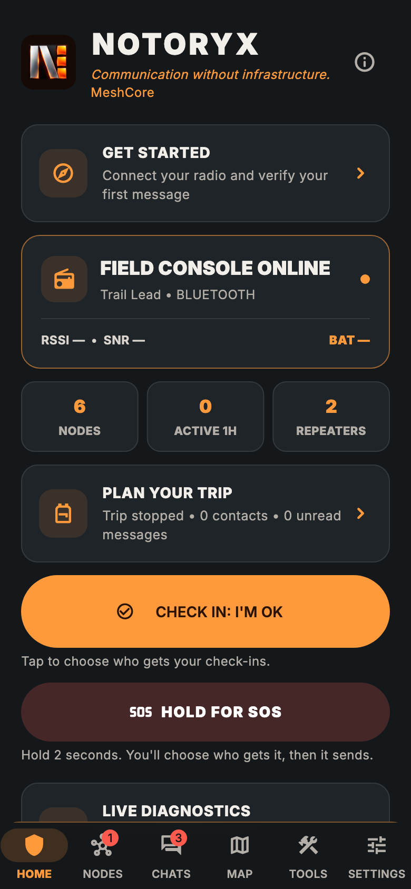
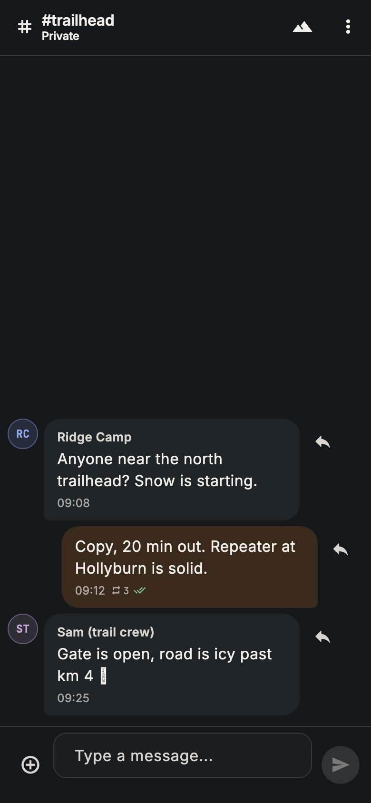
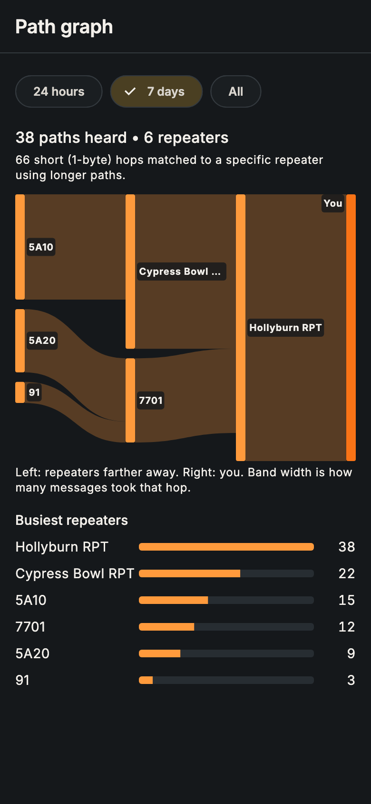

  

# NOTORYX Core downloads

**Off-grid messaging, check-ins and SOS over your MeshCore LoRa radio.** Part of the **NOTORYX** off-grid communications family. **No Towers. No Limits.**

This repository only hosts NOTORYX Core builds. Get the latest from **[Releases](../../releases)**.

  
  
  

> NOTORYX Core is a pre-release. It is not a replacement for an emergency service or a satellite messenger.

## Which file do I need?

| Platform | File | Notes |
|---|---|---|
| Android (ARM64 phones) | `NOTORYX-Core-…-arm64-v8a.apk` | Signed with the NOTORYX Core release key |
| macOS (Intel and Apple silicon, macOS 14+) | `NOTORYX-Core-…-macOS-universal.zip` | Not notarized by Apple (see below) |

Each release also has `SHA256SUMS-Android.txt` and `SHA256SUMS-macOS.txt`. To check a download: `shasum -a 256 <file>`.

## Install on Android

1. On your phone, open the latest release and download the `.apk`.
2. Open the file. If Android asks, allow installs from your browser or file manager.
3. Open NOTORYX Core and allow **Bluetooth**, **location** and **notifications** when asked.

Newer versions install over older ones and keep your data. (Test builds before 10.0.0-rc.10 used a different key: make an encrypted backup in **Tools → Encrypted backup**, uninstall, install the new version and restore.)

## Install on a Mac

1. Download the `.zip` and double-click it to unzip.
2. Drag **NOTORYX Core** into your **Applications** folder.
3. Open it. The first time, macOS says it can't check the app for malicious software, because it isn't notarized. Click **Done**, then go to **System Settings → Privacy & Security** and click **Open Anyway** next to "NOTORYX Core was blocked". You do this once per version.
4. Allow Bluetooth when asked.

## About

NOTORYX Core is an independent community app. It is not an official MeshCore app and doesn't imply endorsement by MeshCore; see [meshcore.io](https://meshcore.io/). It builds on the open-source [MeshCore Open](https://github.com/zjs81/meshcore-open) project (MIT). License text and third-party notices are in the app's **Open source licenses** screen.
