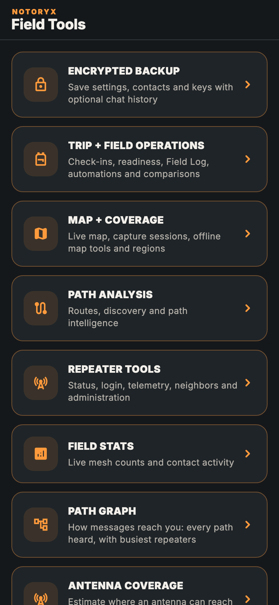
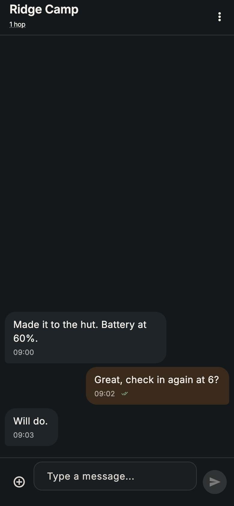

  

# NOTORYX Core downloads

**Off-grid messaging, check-ins and SOS over your MeshCore LoRa radio.** Part of the **NOTORYX** off-grid communications family. **No Towers. No Limits.**

This repository hosts NOTORYX Core builds for Android and Mac. Get the latest from **[Releases](../../releases)**.

  
  
  
  

## Why NOTORYX Core?

NOTORYX Core turns your phone or Mac and a [MeshCore](https://meshcore.io/) radio into a field communicator that works with no cell service, no Wi-Fi and no internet. Here's why it's worth carrying:

- **SOS that keeps trying.** Hold the button for 2 seconds and your radio's position goes to your trip contacts. It repeats every 5 minutes until someone answers or you stop it, and **I'm safe** sends the all-clear.
- **Check-ins that tell you who got them.** I'm OK, At camp, Delayed and Heading back show exactly who each one reached, and you can resend to anyone it missed. Overdue alerts warn you when a trip contact goes quiet.
- **You can actually see the mesh.** The path graph draws every route your messages take, ranks the busiest repeaters and even figures out which repeater a short 1-byte hop really was. Antenna coverage shows where an antenna at a chosen height could reach over real terrain.
- **It tells you when your radio's on the wrong settings.** NOTORYX Core knows the settings local meshes have agreed on, warns you when your radio doesn't match and switches it after you confirm.
- **It reaches past the horizon.** The optional MQTT bridge shows MeshCore traffic from beyond radio range, clearly labeled **via MQTT** so it never pretends to be a radio repeat.
- **It's made for the dark, the sun and everything in between.** Four themes, including Red light to keep your night vision and Alpine day for bright snow, all checked for readable contrast.
- **It speaks your language.** 17 languages.
- **It runs your whole kit.** Repeaters, room servers, sensors, access control, a command line and Wi-Fi setup are all in one app.
- **It's free and open source** (MIT), and built on the community [MeshCore Open](https://github.com/zjs81/meshcore-open) project.

## Everything it does

### Safety and trips
- **SOS:** hold for 2 seconds to send your radio's position to your trip contacts (and an optional channel). It repeats every 5 minutes until someone replies or you stop it. **I'm safe** sends an all-clear.
- **Check-ins:** I'm OK, At camp, Delayed and Heading back. See who each one reached and resend to anyone it missed.
- **Check-in reminders:** a phone notification when you're due to check in, even when the app is closed.
- **Overdue alerts:** a warning when a trip contact goes quiet for longer than you set.
- **Plan your trip:** choose up to six contacts. Trip briefs, a **Field Log** of everything sent and received, readiness checks and optional automations.
- **Field Console** home screen: radio status, signal and battery at a glance, plus live diagnostics.

### Messaging
- Direct and channel messages with delivery status, reactions, GIFs and image messages.
- **Message search** across everything saved on the device.
- **Drafts** kept for each chat.
- **Share your position or a contact** from the message box. Received contacts can be added in one tap.
- **Read messages aloud** (optional) and on-device translation.
- **Area-limited channel messages** that stay within a radius of you (needs radios running flood-corridor firmware).
- Optional auto-delete of old channel messages.
- **Bot Mode** auto-replies.

### Maps, paths and coverage
- Live mesh map with **offline map packs**.
- **Path graph:** every path you've heard, drawn as flows from far repeaters to you, with the busiest repeaters ranked. Short 1-byte hops are matched to a specific repeater using longer paths.
- **Route intelligence** that handles 1-, 2- and 3-byte hop IDs, plus path discovery and traces.
- **Antenna coverage:** see where an antenna at a chosen height could reach over the terrain.
- **Line-of-sight checks** between two points.
- **Coverage capture sessions** you can record, review and export.
- **Field stats:** live mesh counts and contact activity.

### MQTT bridge (optional)
- Connect to an MQTT broker over TLS or secure WebSocket to see MeshCore traffic from beyond radio range. Broker passwords are kept in the system keychain, never in plain settings.
- **Live packet feed** of what arrives over MQTT. Channel messages that reached you only over the internet are marked **via MQTT** and never count as radio repeats.
- **Observer sharing** sends what your radio hears to the broker in the community `meshcoretomqtt` format. It's off until you turn it on, and direct messages and your own traffic each need a separate opt-in.
- **LetsMesh-style brokers:** sign in with a token signed by your radio, so its private key never leaves it. US and EU LetsMesh presets are included (community services, not part of NOTORYX).
- Reconnects on its own when your network comes back.

### Your radios
- Connect over **Bluetooth, USB or TCP/IP**, and reconnect to your last radio automatically.
- **Connections dashboard:** radio and MQTT status side by side, device and firmware details, and a clear prompt when Bluetooth is off.
- Radio overview with battery, firmware and LoRa settings, live radio stats and a noise-floor chart.
- **Local mesh settings:** knows the settings local meshes have agreed on (for example Philadelphia's 919.500 MHz preset), tells you when your radio doesn't match, and switches it after you confirm.
- **Repeater and room-server tools:** login, status, neighbors, telemetry, settings, command line and **access control** (who can log in as admin, read & write, or read only).
- **Live sensor updates:** sensors push readings when they change.
- **Command line and Wi-Fi setup** for your own radio. With permission, you can also use a trusted contact's command line.
- Join a community by scanning its QR code.

### Backups and everyday comfort
- **Encrypted backup** of settings, contacts and keys, with optional chat history.
- **Battery saver** and app-icon shortcuts.
- **Four themes:** Blaze (default), Topo night, Red light (keeps your night vision) and Alpine day (for bright sun), all checked for readable contrast.
- Available in **17 languages**. A few screens (bot settings and the local mesh settings banner) are still in English only.

  
  
  
  

  
  
  
  

<em>Blaze · Topo night · Red light · Alpine day</em>

> NOTORYX Core is a pre-release. It's tested in automated tests and a mesh simulator but not yet on a wide range of phones and radios. It is not a replacement for an emergency service or a satellite messenger.

## Which file do I need?

| Platform | File | Notes |
|---|---|---|
| Android (ARM64 phones) | `NOTORYX-Core-…-arm64-v8a.apk` | Signed with the NOTORYX Core release key |
| macOS (Intel and Apple silicon, macOS 14+) | `NOTORYX-Core-…-macOS-universal.zip` | Not notarized by Apple (see below) |

Each release also has `SHA256SUMS-Android.txt` and `SHA256SUMS-macOS.txt`. To check a download: `shasum -a 256 <file>`.

## Install on Android

1. On your phone, open the latest release and download the `.apk`.
2. Open the file. If Android asks, allow installs from your browser or file manager.
3. Open NOTORYX Core and allow **Bluetooth**, **location** and **notifications** when asked.

Newer versions install over older ones and keep your data. (Test builds before 10.0.0-rc.10 used a different key: make an encrypted backup in **Tools → Encrypted backup**, uninstall, install the new version and restore.)

## Install on a Mac

1. Download the `.zip` and double-click it to unzip.
2. Drag **NOTORYX Core** into your **Applications** folder.
3. Open it. The first time, macOS says it can't check the app for malicious software, because it isn't notarized. Click **Done**, then go to **System Settings → Privacy & Security** and click **Open Anyway** next to "NOTORYX Core was blocked". You do this once per version.
4. Allow Bluetooth when asked.

## About

NOTORYX Core is an independent community app. It is not an official MeshCore app and doesn't imply endorsement by MeshCore; see [meshcore.io](https://meshcore.io/). It builds on the open-source [MeshCore Open](https://github.com/zjs81/meshcore-open) project (MIT). License text and third-party notices are in the app's **Open source licenses** screen.
