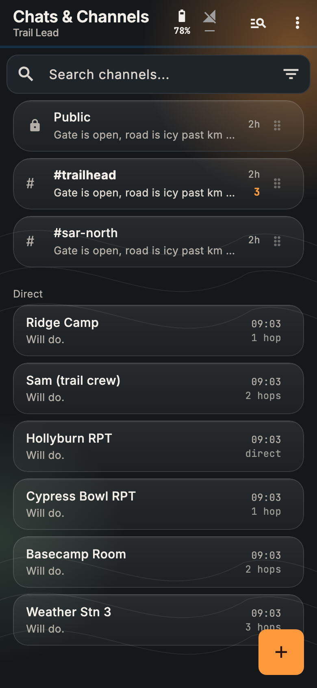
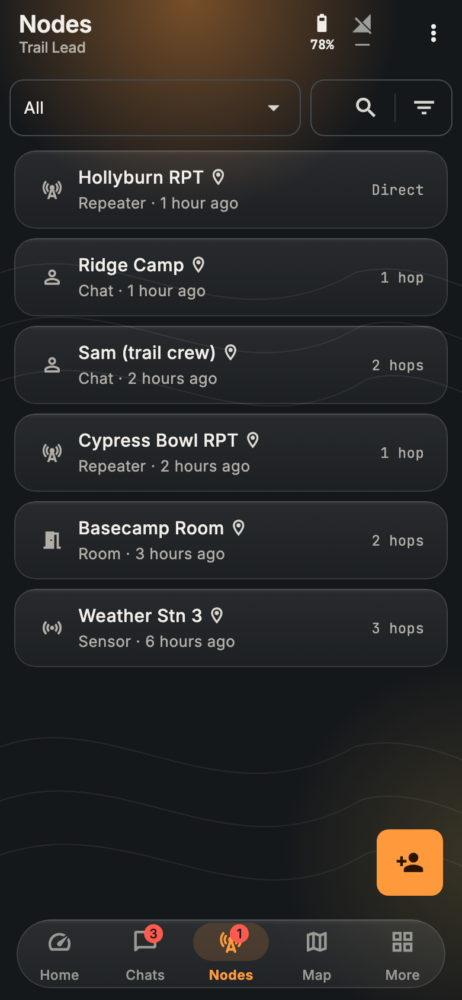
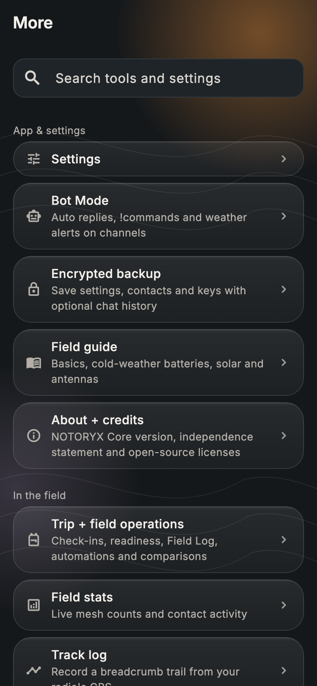
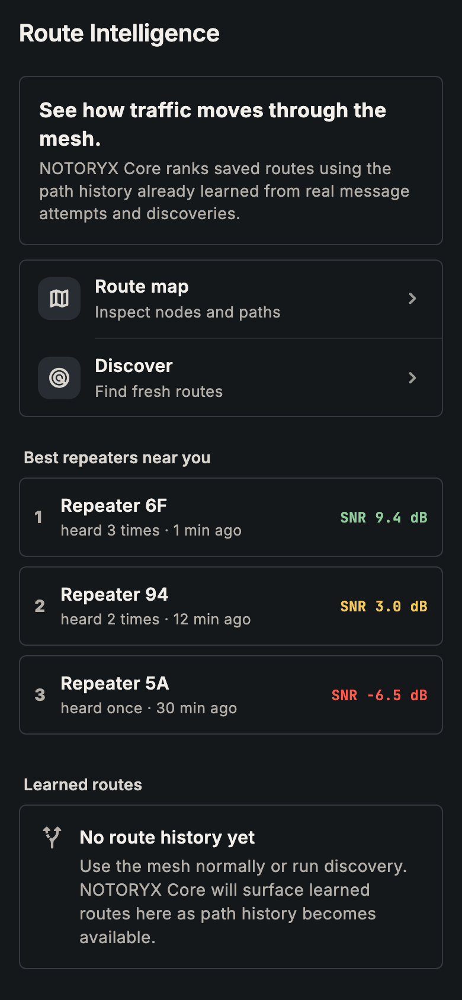
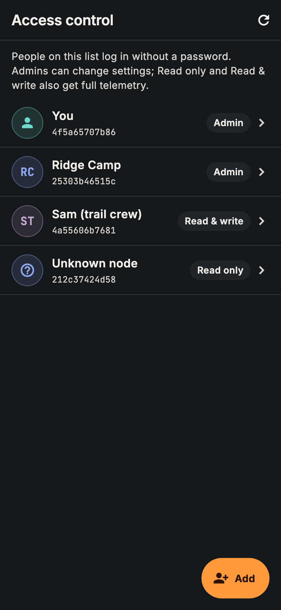
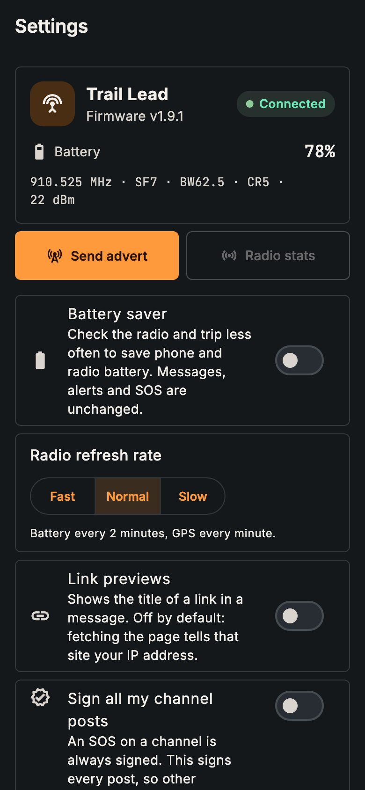
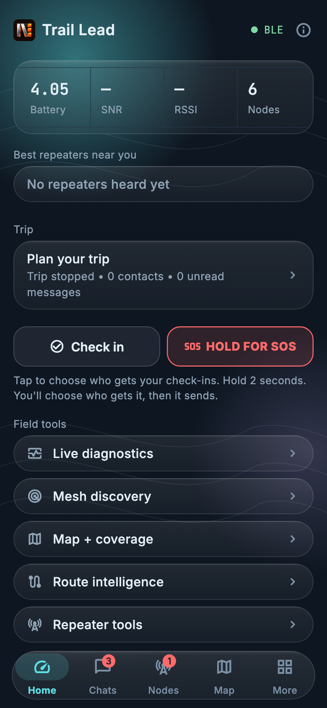
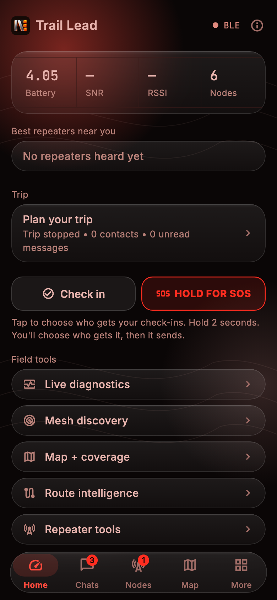
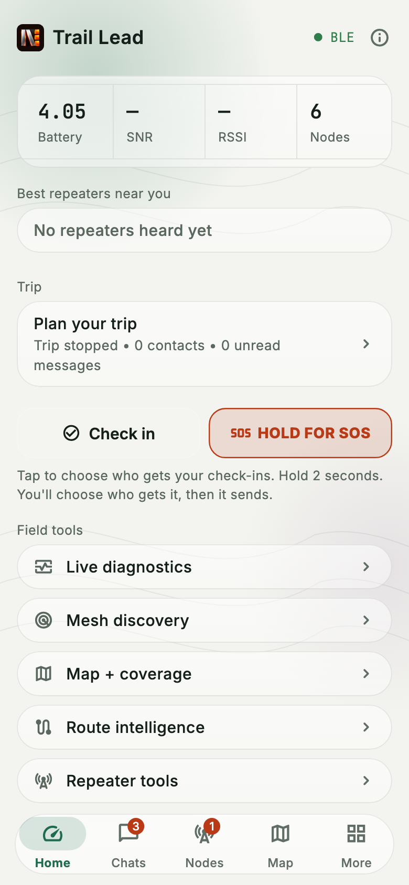

<p align="center">
  
</p>

# NOTORYX Core downloads

**Off-grid messaging, check-ins and SOS over your MeshCore LoRa radio.** Part of the **NOTORYX** off-grid communications family. **No Towers. No Limits.**

This repository hosts NOTORYX Core builds for Android and Mac. Get the latest from **[Releases](../../releases)**.

<p align="center">
  
  
  
  
</p>

## Why NOTORYX Core?

NOTORYX Core turns your phone or Mac and a [MeshCore](https://meshcore.io/) radio into a field communicator that works with no cell service, no Wi-Fi and no internet. Here's why it's worth carrying:

- **SOS that keeps trying, and can be trusted.** Hold the button for 2 seconds and your radio's position goes to your trip contacts. It repeats every 5 minutes until someone answers or you stop it, and **I'm safe** sends the all-clear. A channel SOS is signed with your radio's own key, so other NOTORYX users know it's really you.
- **Check-ins that tell you who got them.** I'm OK, At camp, Delayed and Heading back show exactly who each one reached, and you can resend to anyone it missed. Overdue alerts warn you when a trip contact goes quiet.
- **You can actually see the mesh.** The path graph draws every route your messages take, ranks the busiest repeaters and even figures out which repeater a short 1-byte hop really was. Antenna coverage shows where an antenna at a chosen height could reach over real terrain.
- **It gets your radio on the right settings.** MeshCore's community presets (USA, Canada, EU/UK, Australia and more) are built in, with the one for your country suggested first. It also knows settings local meshes have agreed on, and warns you when your radio doesn't match.
- **It helps you find people.** A directory of public channels, channels heard on air that you haven't joined, and the #channels active online right now, each one tap to join.
- **It reaches past the horizon.** The optional MQTT bridge shows MeshCore traffic from beyond radio range, clearly labeled **via MQTT** so it never pretends to be a radio repeat.
- **It looks the part.** The Frosted ember look puts see-through glass over a warm glow. Four themes, including Red light to keep your night vision and Alpine day for bright snow, all checked for readable contrast.
- **It speaks your language.** 18 languages.
- **It runs your whole kit.** Repeaters, room servers, sensors, access control, a command line and Wi-Fi setup are all in one app.
- **It's free and open source** (MIT), and built on the community [MeshCore Open](https://github.com/zjs81/meshcore-open) project.

## Everything it does

### Safety and trips
- **SOS:** hold for 2 seconds to send your radio's position to your trip contacts (and an optional channel). It repeats every 5 minutes until someone replies or you stop it. **I'm safe** sends an all-clear.
- **Check-ins:** I'm OK, At camp, Delayed and Heading back. See who each one reached and resend to anyone it missed.
- **Check-in reminders:** a phone notification when you're due to check in, even when the app is closed.
- **Overdue alerts:** a warning when a trip contact goes quiet for longer than you set.
- **Signed SOS:** a channel SOS carries a signature from your radio's key. You can sign every channel post too; a post whose signature doesn't check out shows as unverified, and other apps just see the normal message.
- **Plan your trip:** choose up to six contacts. Trip briefs, a **Field Log** of everything sent and received, readiness checks and optional automations.
- **Home:** radio battery, signal and node count at a glance, your radio's own **sensors** (voltage, temperatures, GPS, light), check-in, SOS and field tools.
- **Android home-screen widget:** radio status, battery and unread count, with one-tap Check in and SOS.

### Messaging
- Direct and channel messages with delivery status, reactions, GIFs and image messages. Tapping a notification opens that chat.
- **Find channels:** a directory of public hashtag channels (local ones first), channels heard on air that you haven't joined, and **Active online** from an online analyzer, each with one-tap Join.
- **Link previews** (off by default).
- **Message search** across everything saved on the device.
- **Drafts** kept for each chat.
- **Share your position or a contact** from the message box. Received contacts can be added in one tap.
- **Read messages aloud** (optional) and on-device translation.
- **Area-limited channel messages** that stay within a radius of you (needs radios running flood-corridor firmware).
- Optional auto-delete of old channel messages.
- **Bot Mode:** auto-replies, keyword rules and commands like `!ping`, `!sun`, `!moon`, `!weather`, `!dice` and `!trace`, in direct messages and in the channels you choose, plus weather alerts posted to a channel.

### Maps, paths and coverage
- Live mesh map with **offline map packs**.
- **Path graph:** every path you've heard, drawn as flows from far repeaters to you, with the busiest repeaters ranked. Short 1-byte hops are matched to a specific repeater using longer paths.
- **Route intelligence** that handles 1-, 2- and 3-byte hop IDs, ranks the best repeaters you hear directly, plus path discovery and traces.
- **Observer reach:** see which online observers heard your message, how many hops it took and the best signal. Unknown repeaters can be named online. Both use a CoreScope analyzer you choose.
- **Coverage hexagons:** record where your radio got through and upload to your own endpoints, with a privacy delay. **Track log** with GPX export.
- **Antenna coverage:** see where an antenna at a chosen height could reach over the terrain.
- **Line-of-sight checks** between two points.
- **Coverage capture sessions** you can record, review and export.
- **Field stats:** live mesh counts and contact activity.

### MQTT bridge (optional)
- Connect to **several MQTT brokers at once** over TLS or secure WebSocket to see MeshCore traffic from beyond radio range, with a Wi-Fi-only option and an offline queue. Broker passwords are kept in the system keychain, never in plain settings.
- **Live packet feed** of what arrives over MQTT. Channel messages that reached you only over the internet are marked **via MQTT** and never count as radio repeats.
- **Observer sharing** sends what your radio hears to the broker in the community `meshcoretomqtt` format. It's off until you turn it on, and direct messages and your own traffic each need a separate opt-in.
- **LetsMesh-style brokers:** sign in with a token signed by your radio, so its private key never leaves it. US and EU LetsMesh and MeshRank presets are included (community services, not part of NOTORYX).
- Reconnects on its own when your network comes back.

### Your radios
- Connect over **Bluetooth, USB or TCP/IP**, and reconnect to your last radio automatically.
- **Connections dashboard:** radio and MQTT status side by side, device and firmware details, and a clear prompt when Bluetooth is off.
- Radio overview with battery, firmware and LoRa settings, live radio stats and a noise-floor chart.
- **Radio presets:** MeshCore's community catalogue with search and a suggestion for your country. Choosing one keeps your transmit power.
- **Local mesh settings:** knows the settings local meshes have agreed on (for example Philadelphia's 919.500 MHz preset), tells you when your radio doesn't match, and switches it after you confirm.
- **Send your advert** zero-hop (only radios that hear you directly) or flooded across the mesh.
- **Repeater and room-server tools:** login, status, neighbors, telemetry, settings, command line and **access control** (who can log in as admin, read & write, or read only).
- **Live sensor updates:** sensors push readings when they change.
- **Command line and Wi-Fi setup** for your own radio. With permission, you can also use a trusted contact's command line.
- **Field tools:** repeater ping (signal both ways), antenna hunt (clicks faster as a repeater gets louder), Repeater IDs, Region setup (US and Canada region trees) and a field guide.
- Join a community by scanning its QR code.

### Backups and everyday comfort
- **Encrypted backup** of settings, contacts and keys, with optional chat history.
- **Battery saver**, adjustable refresh rate and app-icon shortcuts.
- **Four themes:** Blaze (default), Topo night, Red light (keeps your night vision) and Alpine day (for bright sun), all checked for readable contrast.
- Available in **18 languages**. A few screens (parts of bot settings and the local mesh settings banner) are still in English only.

<p align="center">
  
  
  
  
</p>

<p align="center">
  
  
  
  
</p>
<p align="center"><em>Blaze · Topo night · Red light · Alpine day</em></p>

> NOTORYX Core is a pre-release. It's tested in automated tests and a mesh simulator but not yet on a wide range of phones and radios. It is not a replacement for an emergency service or a satellite messenger.

## Which file do I need?

| Platform | File | Notes |
|---|---|---|
| Android (ARM64 phones) | `NOTORYX-Core-…-arm64-v8a.apk` | Signed with the NOTORYX Core release key |
| macOS (Intel and Apple silicon, macOS 14+) | `NOTORYX-Core-…-macOS-universal.zip` | Not notarized by Apple (see below) |

Each release also has `SHA256SUMS-Android.txt` and `SHA256SUMS-macOS.txt`. To check a download: `shasum -a 256 <file>`.

## Install on Android

1. On your phone, open the latest release and download the `.apk`.
2. Open the file. If Android asks, allow installs from your browser or file manager.
3. Open NOTORYX Core and allow **Bluetooth**, **location** and **notifications** when asked.

Newer versions install over older ones and keep your data. (Test builds before 10.0.0-rc.10 used a different key: make an encrypted backup in **More → Encrypted backup**, uninstall, install the new version and restore.)

## Install on a Mac

1. Download the `.zip` and double-click it to unzip.
2. Drag **NOTORYX Core** into your **Applications** folder.
3. Open it. The first time, macOS says it can't check the app for malicious software, because it isn't notarized. Click **Done**, then go to **System Settings → Privacy & Security** and click **Open Anyway** next to "NOTORYX Core was blocked". You do this once per version.
4. Allow Bluetooth when asked.

## Local mesh settings

NOTORYX Core knows the radio settings local meshes have agreed on, and offers to switch your radio when they don't match. The live list is [`regional_presets.json`](regional_presets.json) in this repository: the app checks it every 12 hours and also ships a built-in copy.

To add or update your area, [open an issue](../../issues/new) with the area name, center and radius, frequency, bandwidth, spreading factor, coding rate and path-hash size, and say where the settings come from. Each entry looks like this:

```json
{
  "id": "us-philadelphia",
  "name": "Philadelphia",
  "center": [39.9526, -75.1652],
  "radiusKm": 100,
  "frequencyMHz": 919.5,
  "bandwidthKHz": 500,
  "spreadingFactor": 10,
  "codingRate": 5,
  "pathHashBytes": 2,
  "updated": "2026-10-17",
  "notes": "Where this comes from and anything people should know."
}
```

Changing `updated` is what tells the app the settings changed.

## About

NOTORYX Core is an independent community app. It is not an official MeshCore app and doesn't imply endorsement by MeshCore; see [meshcore.io](https://meshcore.io/). It builds on the open-source [MeshCore Open](https://github.com/zjs81/meshcore-open) project (MIT). License text and third-party notices are in the app's **Open source licenses** screen.
